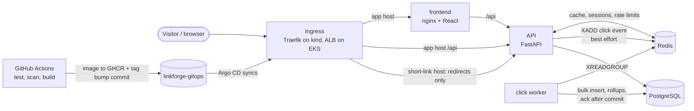
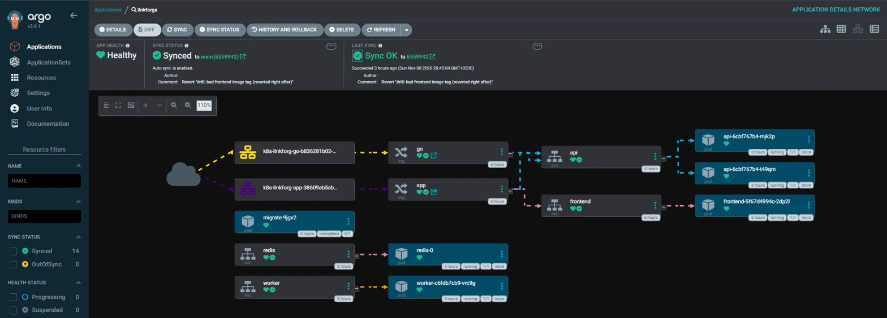
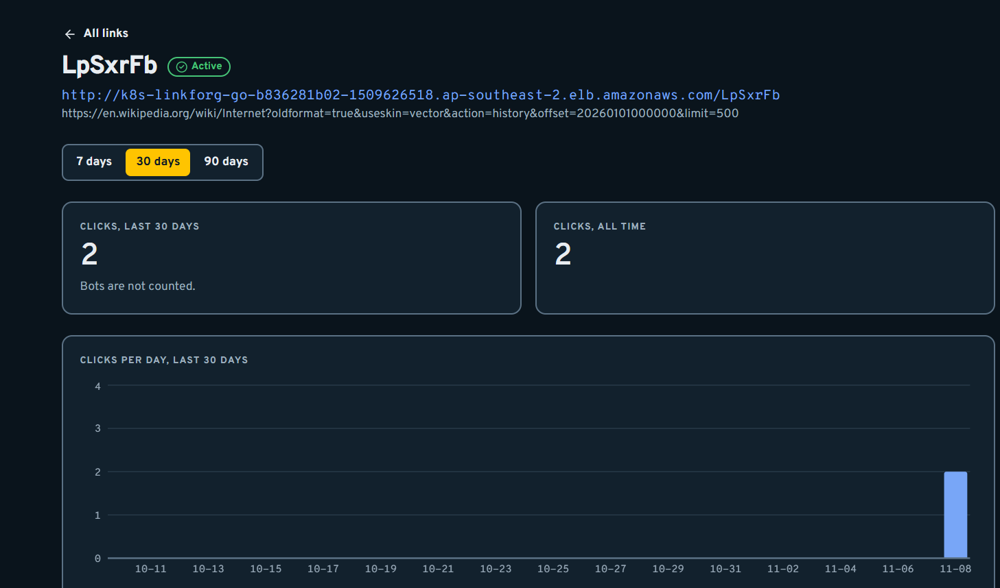

# LinkForge

A URL shortener with click analytics, built as a **DevOps portfolio project**: the application is small on purpose, and the point is everything around it:
tests against real databases, a gated CI pipeline, GitOps on Kubernetes, secrets handled safely, observability, load tests and failure drills, and a real deployment on AWS EKS.

Two repositories: **this one** (application, tests, Terraform, scripts, docs) and [`linkforge-gitops`](https://github.com/Saicharan519/linkforge-gitops) (Helm chart, per-environment values, Argo CD applications).

## What it does
- Create a short link (`/<code>`), open it, get a **302** redirect. Unknown or disabled code: 404, expired: 410.
- Counts clicks (bots are not counted) and shows them per day in a dashboard. Accounts, sessions and API keys (`X-API-Key`) for programmatic use.
- Stack: Python 3.12 + FastAPI + SQLAlchemy (async) + PostgreSQL 16, Redis 7 (cache, sessions, click stream), a click worker, React + TypeScript (Vite).

## Architecture



Design rules that matter (the full list is in [`CLAUDE.md`](CLAUDE.md) and [`docs/ARCHITECTURE.md`](docs/ARCHITECTURE.md)):
a Redis failure never turns a redirect into a 500 (every Redis call has a short timeout and a fallback); a lost click is acceptable, a failed redirect is not;
the worker acknowledges a click only after the database commit; the public short-link host serves only `GET`/`HEAD /{code}`; metrics ports are never behind an Ingress.

## Run it locally (3 commands)
```bash
git clone https://github.com/Saicharan519/linkforge.git
cd linkforge
docker compose up --build
```
The app is on <http://localhost:8080> (register a test account, create a link). Short links open on `http://localhost:8000/<code>`. The compose stack was verified in phase P5 (see [`docs/RESULTS.md`](docs/RESULTS.md)).
Development commands (tests, lint, hot reload) are in [`CLAUDE.md`](CLAUDE.md).

## What is proven, and how
Every number below has its method and its limits in [`docs/RESULTS.md`](docs/RESULTS.md); checks before the cloud are in [`docs/VERIFICATION.md`](docs/VERIFICATION.md).

| Area | Evidence |
|---|---|
| Tests | integration tests run against **real PostgreSQL and Redis** (no mocks), in CI on every pull request |
| CI gates | ruff + pytest, frontend lint/types/tests/build, Trivy (files and images), Checkov + `terraform validate`, pip-audit/npm audit, gitleaks; `main` is branch-protected and needs all of them green |
| Local Kubernetes | kind + Helm + Argo CD (app-of-apps, sync waves) + Sealed Secrets + kube-prometheus-stack (dashboard, 11 alert rules unit-tested with promtool) |
| Load, kind | warm redirect 200 req/s for 3 min: 100% 302, server-side p95 about 9 ms; the autoscaler went from 2 to 6 pods; bottleneck found: the 500m CPU limit of the API pods |
| Load, AWS EKS | 2 x `m7i-flex.large`: warm redirect 200 req/s, 36,001 redirects, 100% 302, **client-side p95 3.4 ms** measured from a pod inside the cluster straight to the API Service (the load balancer and the internet are not in that number); autoscaler 2 to 5 pods in about a minute |
| Failure drills, AWS | kill an API pod under load: 0 of 18,201 requests failed; kill Redis: back in 20 s, redirects unaffected, 8.4% of the clicks in that window not recorded (by design); worker down for a minute: 6,001 queued clicks drained in under 9 s, none lost; bad image tag: the old pod kept serving and `git revert` rolled back in 19 s |

Screenshots from the AWS run:




## How it is deployed
- **CI/CD:** GitHub Actions builds, scans and pushes images to GHCR, then commits the new tag to `linkforge-gitops`; **Argo CD** is the only thing that deploys. CI never runs `kubectl`.
- **kind (local):** one command builds the whole cluster from nothing: [`docs/RUNBOOK-kind-cluster.md`](docs/RUNBOOK-kind-cluster.md).
- **AWS EKS:** Terraform (`infra/terraform/cloud`: VPC, EKS with Pod Identity, RDS PostgreSQL with enforced TLS, EBS gp3 for Redis) plus the scripts in `scripts/` and a step-by-step guide for a beginner: [`docs/RUNBOOK-eks-run-day.md`](docs/RUNBOOK-eks-run-day.md).
  The AWS account used has real limits (one region, no OIDC provider, restricted Free-plan instance types), which shaped the design; the decisions are in [`docs/DECISIONS.md`](docs/DECISIONS.md) (D76, D86 to D90).

## Honest limits
- The AWS run used **plain HTTP and no domain** (each Ingress became its own load balancer with an AWS-generated name, so the short links are long). Only throw-away test accounts were used. HTTPS with a domain is described but not run.
- There is no Prometheus on the EKS cluster, so the AWS latency numbers are client-side only. The cross-node reattachment of Redis's EBS disk was not tested.
- Slack alert delivery was not tested. Several decisions record what was *not* verified; read them before quoting a number.
- Load tests ran in the cluster against the API directly; they are not a statement about internet latency.

## Documentation map

| Read this | For |
|---|---|
| [`docs/PRD.md`](docs/PRD.md) | what is built and what is deliberately not |
| [`docs/ARCHITECTURE.md`](docs/ARCHITECTURE.md) | flows, schema, API, Redis keys, failure behaviour, budgets |
| [`docs/SECURITY.md`](docs/SECURITY.md) | threat model and controls |
| [`docs/DECISIONS.md`](docs/DECISIONS.md) | every design decision with its reason (D1 to D90) |
| [`docs/TASKS.md`](docs/TASKS.md) | the phases and the progress log |
| [`docs/RESULTS.md`](docs/RESULTS.md), [`docs/VERIFICATION.md`](docs/VERIFICATION.md) | measured numbers, drills and checks, with caveats |
| [`docs/DEVOPS_GUIDE.md`](docs/DEVOPS_GUIDE.md) | the DevOps concepts used, written for learning |
| `docs/RUNBOOK-*.md`, [`docs/LEARNING-WALKTHROUGHS.md`](docs/LEARNING-WALKTHROUGHS.md) | how to run, operate and rebuild each part |
| [`CLAUDE.md`](CLAUDE.md) | the working rules and invariants the code is held to |

Layout: `backend/` (API and worker), `frontend/`, `infra/` (Terraform, kind, k6, raw manifests), `scripts/`, `docs/`, `.github/workflows/`.
